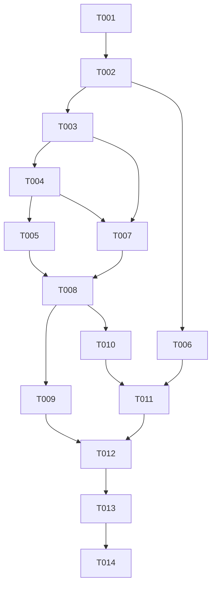

# P029 表歧镜 TableFork｜完整实施计划书

**项目：** `P029-tablefork`　**SPEC_VERSION：** `1.0.2`　**日期：** `2026-11-20`  
**状态：** `READY_FOR_DISPATCH / IMPLEMENTATION_NOT_STARTED`　**唯一规格权威：** `PROJECT_BOOK.md` v1.0.2  
**责任：** Muse 只派工、执行门禁、整理证据、归档；编码/独立 Oracle/审查/合并/发布由 Muse 调度**已有可用的免费 Coding Agent**，每张卡在平台**全新会话**完成。实际设备/浏览器/模型列表由 Muse 自身记录，本文不臆造。

> **勘误注 v1.0.1（2026-11-21，裁决者 Muse）：** 本计划正文无改动，版本号随 `PROJECT_BOOK.md` 升为 v1.0.1；勘误内容见项目书封面勘误注（§5.4 示例、§9 树、归档状态）。另记录在案：P2-03 以冻结规格为准（p95 ≤ 500ms、48/48），T001 交底时注明；P2-04 T005 验收的 Node CLI 调用为自备临时脚本（tsx/node 一次性调用），不是等 T010 的正式 CLI，派工时写明；交接 JSON 模板示例中的 `spec_version` 随版本升为 `1.0.1`。

> **勘误注 v1.0.2（2026-11-21，裁决者 Muse）：** 本计划正文除版本号与 §7 交接 JSON 模板示例中的 `spec_version`（随版本升为 `1.0.2`）外无改动，版本号随 `PROJECT_BOOK.md` 升为 v1.0.2；勘误内容见项目书封面勘误注（§6.1 三字段、§6.2 签名、`inputHash` 定义、§3.1 trim 口径；主聊天裁决 §9 优先，R1 P1-02）。FIX-03 addendum（2026-11-21）：新增 Golden G49（首尾 U+00A0 保留），Golden 总数 48→49；`normalizeCellText` 的首尾 trim 改为仅去 ASCII 空白（实现向 Oracle 对齐，R1 P2 #3）；本计划正文的 Golden 计数同步改为 49。

> 本计划所有 PASS、耗时、测试数、截图和 ZIP 均为**待施工的合同**，不是已完成声明。工时硬预算合计 **88 小时**，`P029-T001`—`P029-T014` 共 14 张主任务卡；若任务需要额外修复，应在对应主卡的新会话下另建 `FIX-...` 子单、说明从哪个预算项调剂，不得悄悄膨胀范围。全部数据合成，零真人参与者。许可证 MIT。

## 1. 冻结约束与开工硬门槛

1. 唯一题目：P029 TableFork；不是 HTML→Markdown 通用转换器、AI 模型、PDF/Office 解析器、网页爬虫或能解释真实业务的表格 AI。
2. 不可随意扩的算法子集：单个 HTML 顶层 `<table>`，最多 `32×12` 槽位、128 源格、64 KiB 输入；仅显式列/行标题；`ORIGIN_EMPTY`、`REPEAT_VALUE`；选取单格拆分见证并**重算 A/B 的 Markdown 相等**。
3. 现有 GitHub 热门和学术论文只是证据，不构成可以复制别人成果的许可证；本项目自有代码 MIT，第三方实际 SPDX 必须逐项复核。
4. 研发测试数据全部人工设计的**合成样本**；不加入真实办公文档、用户凭证或对话记录；不接真人访谈、问卷和真人评测。
5. 本地静态应用、可离线运行、无需 GPU/LLM/商业 API，所有敏感数据可看、可修改、一键清空，无自动外发/持久化。
6. 开始 `T001` 之前，Muse 必须**真正读取**四个实体规范 `PROJECT_BOOK.md/.docx`、`IMPLEMENTATION_PLAN.md/.docx`，确认格式、版本、章节/表格/代码语义一致、非空、可打开，并在 Drive 实际归档（而不是只有会话链接）。
7. 开发默认 Windows 路径兼容，但根据 T001 实机 OS 测试；只在 Linux 真跑不得声称 Windows PASS，写 `WINDOWS_NOT_TESTED`。
8. 每任务一个独立新会话；前一个任务的最新 commit、合同和交接结果必须以文件提供，不依赖旧会话记忆。禁止同一文件并行修改。
9. 所有验收标准以真实运行证据为准；未运行只写 `NOT_RUN`，不可把“已写测试”当通过。
10. 终审在**同一 P029 立项对话**进行，只有 GPT-6 独立判 `FINAL_VERDICT: PASS` 才准发布；若连续 5 轮仍不过，另开“表歧镜 终审续审”并给完整上下文。

## 2. 目录、工具与版本策略

### 2.1 建议工作区树

```text
agent-project-factory/P029-tablefork/
  PROJECT_BOOK.md PROJECT_BOOK.docx
  IMPLEMENTATION_PLAN.md IMPLEMENTATION_PLAN.docx
  P029_IDEATION_REPORT.md
  package.json package-lock.json tsconfig.json vite.config.ts playwright.config.ts
  README.md LICENSE THIRD_PARTY_NOTICES.md SECURITY.md CHANGELOG.md
  src/
    core/{types,parse,grid,headers,flatten,witness,compare,records,report,index}.ts
    worker/{protocol,tablefork.worker}.ts
    ui/{App,InputPanel,DualTableView,MarkdownPanel,ProofPanel,ExportPanel}.tsx
    ui/styles.css main.tsx
    data/presets.ts
  cli/analyze.ts
  fixtures/TFK-A.json TFK-B.json TFK-C.json TFK-D.json
  fixtures/golden/*.json
  oracle/reference.py oracle/golden_expected.json
  tests/core/*.test.ts tests/property/*.test.ts tests/e2e/*.spec.ts
  scripts/verify_release.mjs
  artifacts/{reports,logs,screenshots,release}/
  task_handoffs/P029-T001.json ... P029-T014.json
  review/{REVIEW_INDEX.md,REVIEW_PACK_01.md,REVIEW_PACK_02.md,RELEASE_MANIFEST.json}
```

`docs/` 可选复制 Markdown 作发布文档，但**不**再制造独立权威，避免版本混乱。工作区绝对路径由 Muse 记录，不假设 Windows `D:\` 或 Linux `/home`。

### 2.2 T001 环境探测与版本冻结

```sh
node --version
npm --version
node -p "process.platform + ' ' + process.arch"
git --version
python --version
```

目标包族 Node.js 24.x、TypeScript 5.x、React 19.x、Vite 7.x、Vitest、Playwright（Chromium）、Python 3.12+。**精确版本**只能通过真实 `npm ci` / `npm install` 后的 `package-lock.json` 和环境日志冻结；若现有 VM 使用其他兼容版，T001 记录差异 ADR 并以实际能运行的组合为准。禁止在运行中依赖 CDN/在线字体、模型或 API。技术栈升级要记 ADR 并执行回归。

### 2.3 固定 package scripts

```json
{
  "scripts": {
    "dev": "vite --host 127.0.0.1",
    "typecheck": "tsc --noEmit",
    "test": "vitest run",
    "test:core": "vitest run tests/core tests/property",
    "test:e2e": "playwright test",
    "build": "tsc --noEmit && vite build",
    "analyze": "tsx cli/analyze.ts",
    "oracle": "python oracle/reference.py --fixtures fixtures/golden --expected oracle/golden_expected.json",
    "verify:release": "node scripts/verify_release.mjs"
  }
}
```

`tsx` 作为明确的开发依赖引入并锁定；Node 在 VM 对 Python 命令可能不同，Windows 由 T001 确认 `python` 实际可用。若需要跨系统的 `py -3` 兼容包装，交给 T001 按实测调整脚本并留 ADR。无系统 bash 依赖；发布验证脚本用 Node 标准库读取文件哈希。

## 3. 阶段门禁、任务依赖图与集成顺序

| 阶段 | TASK_ID | 阶段退出条件 |
|---|---|---|
| S0 环境与合同 | T001–T002 | 四规格已验证、lockfile 已冻结、核心类型与 4 个预设入口已锁定 |
| S1 数学可证伪内核 | T003–T006 | 网格/Markdown/最小拆分见证及**独立 Python 预言**一致；A≠B、F(A)=F(B) 真正运行过 |
| S2 传输和可视化 | T007–T010 | 对账、记录输出、三屏 UI、CLI/Worker 预设功能合并，交互保持离线 |
| S3 决定性验证 | T011–T012 | 49/49 Golden、200 个种子、E2E ≥12、截图与真实性能日志齐全 |
| S4 审查、包与 Drive | T013–T014 | 真实源码 ZIP/静态 ZIP 哈希、MIT 与依赖清单、完整源码审查包、独立评审结论齐全，待 GPT 终审 |

**依赖图（前置 → 后置）：**



执行规则：可以并行 T006（仅 `oracle/`）与 T003–T005（仅 `src/core/`），但不能并行修改 `package-lock.json` 或契约类型。T007 与 T005 虽可分别写不同文件，也必须使用已冻结 T004 的 base commit；集成人员负责处理接口冲突，不得两者共同修改 `src/core/index.ts`（T002 主控，T013 集成时允许一次性更新）。

## 4. 接口契约、算法约束与失败语义

### 4.1 完整类型与流程

以项目书第 6.1 节 `AnalyzeInput/Cell/SlotFact/CollisionProof/AnalyzeResult` 为唯一权威。

```text
input(html, markdown?, strategy)
 -> parseValidatedTable
 -> buildGrid(slotOwner/cell)
 -> buildHeaderPaths
 -> F_ORIGIN_EMPTY or F_REPEAT_VALUE
 -> compareSuppliedMarkdown
 -> enumerateSingleSplitCandidates [header-change first, extra-slots, row, col, id]
 -> rebuildAlternativeTable / F(B) / verify A != B and UTF8(F(A)) == UTF8(F(B))
 -> renderFacts / canonicalJson / UI
```

**不可更改的数学边界：** HTML 输入必须是合法限定子集；其他语义 `UNSUPPORTED`；报告“没找到构造见证”不能等价于“无歧义”；`M≠F(A)` 时证书仅针对 `F(A)` 而非用户 M。仅在表头路径改变时显示 `HEADER_ASSOCIATION_CHANGED`，否则只说 `STRUCTURAL_COLLISION`。

**待统一的选择顺序：** 当多个可成功拆分候选存在，优先选择**使已声明标题路径改变**的候选，随后按 `extra_slots=h×w−1` 递增、原点 `row,col,id` 字典序选择；若无标题路径变化者，再按最小拆分代价选结构碰撞候选。这种选择保证主预设演示直观，却不自称全局最小碰撞。若在表头变更的检查中标题未知则不可推测“改变”。此顺序与项目书 §5.2 一致，是两个文档必须保持同步的冻结决定。

### 4.2 JSON 与 worker 失败合同

- `AnalyzeInput.schema` 必须是 `tablefork.input/v1`，报告 `tablefork.report/v1`；未来不兼容更改必须提高 major。
- 源格坐标从 0 开始，cellId 稳定，标题路径为数组，数值不被解析为 JS Number（避免 17 位 ID 精度损坏）。
- API 对无效表报枚举错误：`INVALID_SPAN`、`INVALID_GRID_OVERLAP`、`INVALID_RAGGED_GRID`、`OVER_SIZE`、`UNSUPPORTED_NESTED_TABLE`、`UNSUPPORTED_HEADER_SEMANTICS`、`CANCELLED`。不返回误导性的分析结果。
- Worker `{jobId, type:'ANALYZE'|'CANCEL', payload?}`，回复 `RESULT|ERROR`；主线程仅采纳输入版本完全相同的 `jobId`；取消不覆盖新结果。
- HTML 来源文本仅在静态解析器内，不作为 DOM 的活动 HTML 插入；序列化出来的替代 HTML 也不直接作为用户浏览器 HTML 注入。
- 安全：`textContent`/React 文本节点展示用户内容；不执行 script、img、iframe、外链 CSS，设置 CSP。禁止未批准的出站网络。

### 4.3 黄金实例字段合同

每个 `fixtures/golden/GXX.json`:

```json
{
  "fixture_id": "G09",
  "schema": "tablefork.fixture/v1",
  "input": {
    "schema": "tablefork.input/v1",
    "html": "<table><thead><tr><th colspan=\"2\">预算</th></tr></thead><tbody><tr><td>120</td><td>80</td></tr></tbody></table>",
    "strategy": "ORIGIN_EMPTY"
  },
  "expected_ref": "G09"
}
```

`oracle/golden_expected.json` 含事先人工计算并独立评审的 `slotOwner`、`cellRoles`、`F(A)`、`F(B)`、碰撞与失败预期，按 ID 查找；不能在首轮生成时运行被测 TS 算法作为金标准。四个 demo `TFK-A..D` 由 T010 编写并按此合同验收。

### 4.4 一线安全边界

- 表格文本包含 HTML 标签时当文本处理，不应触发 active DOM；恶意字符串测试覆盖 `<script>`, ``, 事件属性、链接与 CSS。
- 单元格实体解码/空白折叠前后区别须明示，禁止宣称 HTML 原字节无损。
- 64 KiB/32×12 之外显式报错；超长 `rowspan`、`colspan` 不进入二次修复或猜测分支。
- 真实用户复制 JSON 可能包含原文，由用户决定是否导出；内存清空必须清除 UI 状态和 Blob URL。

## 5. 原子任务卡总表：总计 88 小时

| TASK_ID | 工时 | 工种（从 Muse 已实测的免费平台分配） | 唯一写入归属 | 前置 | 主验收 |
|---|---:|---|---|---|---|
| P029-T001 | 4 | 环境/脚手架 | `package*`, `vite.config.ts`, `tsconfig.json`, `playwright.config.ts` | 四规格 | `npm ci; npm run typecheck` |
| P029-T002 | 7 | 架构/契约 | `src/core/types.ts`, `src/core/index.ts`, `src/worker/protocol.ts` | T001 | 类型、错误枚举一致 |
| P029-T003 | 9 | 算法工程 | `src/core/parse.ts`, `grid.ts`, `headers.ts` | T002 | grid/headers 单测 |
| P029-T004 | 7 | 算法工程 | `src/core/flatten.ts` | T003 | 两个 F 策略手算一致 |
| P029-T005 | 8 | 算法工程 | `src/core/witness.ts` | T004 | A≠B、F(A)=F(B) 且签出结构差异 |
| P029-T006 | 6 | **独立 Oracle** | `oracle/reference.py`, `oracle/golden_expected.json` | T002（不读取 T003–T005 实现） | 独立样本输出，同行评阅 |
| P029-T007 | 8 | I/O 与边界工程 | `src/core/compare.ts`, `src/io/*` | T003–T004 | 真实 UTF-8 严格对账、出错定位 |
| P029-T008 | 8 | 格路径/报告工程 | `src/core/records.ts`, `report.ts` | T005+T007 | 来源坐标、未知标题、JSON 纯函数 |
| P029-T009 | 7 | 前端/信息设计 | `src/ui/*`, `src/main.tsx`, `src/ui/styles.css` | T008 | 三屏 UI 与 ARIA/窄屏 |
| P029-T010 | 6 | CLI/Worker/预设 | `cli/*`, `src/worker/tablefork.worker.ts`, `src/data/presets.ts`, `fixtures/TFK-*.json` | T008 | CLI 和预设与浏览器相同结论 |
| P029-T011 | 6 | **独立测试工程** | `fixtures/golden/*.json`, `tests/core/*`, `tests/property/*` | T006+T010 | Golden 49、种子 200、oracle 全相等 |
| P029-T012 | 5 | **不同模型 E2E** | `tests/e2e/*`, `artifacts/screenshots/*`, `artifacts/logs/*` | T009+T011 | E2E ≥12，真实截图、离线、耗时 |
| P029-T013 | 5 | 构建/集成/合规 | `scripts/verify_release.mjs`, `README.md`, `LICENSE`, `SECURITY.md`, `THIRD_PARTY_NOTICES.md`, `CHANGELOG.md`, `artifacts/release/*`, `review/*` | T012 | 可重建包，SHA 与全源码覆盖 |
| P029-T014 | 2 | **独立审查工种** | `review/INDEPENDENT_REVIEW.md`, `task_handoffs/P029-T014.json` | T013 | 独立阅读、复测关键路径，阻断反馈/交接 |
| **总计** | **88** | | | | |

**所有任务共同的禁写规则：** 不修改自身唯一写入归属之外的文件；不添加调用收费 API/外部模型；不把生成 Golden 等于被测系统输出；不引入真实用户数据；不改变冻结输入边界。任务内任何发现需要改上游接口，提交 `ADR-P029-NN.md` 和申请新版上游任务，新独立会话施工；不能跨文件悄悄修。

## 6. 逐卡可直接派给免费模型的执行合同

以下卡片每张都有**输入、指定输出、禁止修改、验收命令、预期证据、完成定义、失败回退**。全部指令通过 Muse 给各模型平台的**全新会话**下发，不能依赖该平台旧聊天。表中工时包含审查和必要小修。

### P029-T001｜工程环境与可重复脚手架（4h）

- **目标：** 在 VM 发现真实 OS/Node/Python/Chromium，完成 React/Vite/TS/Vitest/Playwright 基础脚手架和 lockfile。
- **输入：** 四份冻结规格、P029_IDEATION_REPORT.md、当前空 Git 仓库路径、Muse 授权的依赖安装方法。
- **输出：** `package.json`, `package-lock.json`, `tsconfig.json`, `vite.config.ts`, `playwright.config.ts`, `artifacts/logs/T001-env.txt`, `task_handoffs/P029-T001.json`。
- **禁止修改：** 项目书、计划书、非上述代码、实际用户目录之外的文件。
- **验收命令：** `node -v; npm -v; npm ci; npm run typecheck; npm run build`。
- **证据：** 命令退出码、OS/浏览器与 package-lock 的 SHA-256、工具版本、工作路径和网络/安装限制。
- **DoD：** 新克隆能通过命令；版本与依赖来自真实环境。
- **失败回退：** 不提交失效 lockfile；保留错误日志，把 OS/依赖问题归档为 `ENV_BLOCKED`，由 Muse 换已验证免费平台或兼容依赖后重派新会话。

### P029-T002｜冻结数据契约与错误状态（7h）

- **目标：** 根据项目书第 3/6 节实现 `AnalyzeInput`, `Cell`, `SlotFact`, 错误码、Worker 协议，不写网格算法。
- **输入：** T001 合并 commit、项目书类型示例。
- **输出：** `src/core/types.ts`, `src/core/index.ts`, `src/worker/protocol.ts`, `task_handoffs/P029-T002.json`。
- **禁止修改：** T001 lockfile、`oracle/*`、UI、文档正文。
- **验收命令：** `npm run typecheck; npm test -- --passWithNoTests`（尚无测试时只作为编译契约，不声称功能 PASS）。
- **证据：** 枚举/字段变更记录、公共 API 导出列表、TS 严格类型检查退出码。
- **DoD：** 所有后续任务可在不猜字段的前提下独立实现；接口冻结。
- **失败回退：** 恢复 T001 commit，输出契约冲突列表供新会话修订。

### P029-T003｜表格解析、覆盖网格、明示标题（9h）

- **目标：** 严格限定 HTML 解析、占槽、跨行跨列合法性，输出 slotOwner/Cell 和可声明的列/行标题路径。
- **输入：** T002 commit，项目书 §3.1–3.3，G01–G24 人工测试需求。
- **输出：** `src/core/parse.ts`, `grid.ts`, `headers.ts`, `task_handoffs/P029-T003.json`。
- **禁止修改：** 类型契约、Oracle、UI、lockfile。
- **验收命令：** `npm run typecheck; npm run test:core`（含本卡临时新建的自有模块局部测试，正式测试文件后由 T011 接管）。
- **证据：** 4 个基础样本格矩阵、有效/无效例、明确 unsupported 错误和 SHA。
- **DoD：** 不允许把 ragged/重叠/复杂 header 误判为确定有效。
- **失败回退：** 恢复 T002 基线，记录第一个失败槽位坐标和输入最小化案例。

### P029-T004｜双策略 Markdown 投影（7h）

- **目标：** 基于 canonical grid 生成两个规则完全固定的 `F(A)`，逃逸 `|`、`\`，冻结 LF 及末行行为。
- **输入：** T003 合并 commit、项目书 §5.1、G09–G40 的文本预言。
- **输出：** `src/core/flatten.ts`, `task_handoffs/P029-T004.json`。
- **禁止修改：** T003 `grid.ts` 等、独立 Oracle、UI。
- **验收命令：** `npm run typecheck; npm run test:core`。
- **证据：** 每种策略至少 3 个逐字节输入/输出例、UTF-8 字节 SHA 示例的实际值、CRLF/LF 行为。
- **DoD：** 同一输入连续 100 次完全相同 UTF-8；纯函数无非确定性。
- **失败回退：** 恢复 T003 合并版本，附最短 Markdown 比对差异。

### P029-T005｜单格拆分与反事实碰撞证明（8h）

- **目标：** 按选择排序构造候选 B、重验合法、证明 `A graph != B graph`、`F(A)==F(B)`，区分 header changed 与 structural only。
- **输入：** T004 commit、G09–G32 的反事实例。
- **输出：** `src/core/witness.ts`, `task_handoffs/P029-T005.json`。
- **禁止修改：** `flatten.ts`、Oracle、输入契约/UI。
- **验收命令：** `npm run typecheck; npm run test:core`；额外一条 Node CLI 调用打印 `A!=B` 与二策略 `F(A)==F(B)` 真值。
- **证据：** TFK-A、TFK-B 的 A/B HTML 原文、独立再解析后两类证书、无合并 `NO_WITNESS_FOUND`。
- **DoD：** 至少一组证书构造成功并可经独立重算；“未证实”不误标保真。
- **失败回退：** 不允许用硬编码已知答案绕过算法；保留反例并恢复 T004。

### P029-T006｜与核心隔离的独立 Python Oracle（6h）

- **目标：** 只依书面输入/算法合同独立实现 Python 网格/两个 F/拆分与错误规则；不参考 TS 函数实现。
- **输入：** T002 数据契约、PROJECT_BOOK.md §3–6、已单独手算的 49 个预期列表。
- **输出：** `oracle/reference.py`, `oracle/golden_expected.json`, `task_handoffs/P029-T006.json`。
- **禁止修改：** 全部 `src/*`, `tests/*`, `package*`, 项目书；特别禁止从 T005 输出抄写预期。
- **验收命令：** `python oracle/reference.py --fixtures fixtures/golden --expected oracle/golden_expected.json`（fixtures 未建立齐全时可用 12 个冻结种子先独立运行，其余 T011 补齐后必复测）。
- **证据：** Python 版本、参考算法独立性说明、12 个手算格预言、自测日志。
- **DoD：** 非单纯调用 TS 的包装器，且与主内核由不同模型/独立会话构造。
- **失败回退：** 不向 TS 内核迁就；先锁定书面规则冲突，提交 ADR 供独立决定。

### P029-T007｜用户 Markdown 严格对账（8h）

- **目标：** 只比较用户 M 与本工具 F(A) 的 UTF-8 严格字节流，并检测 GFM 子集是否受支持；首个不同字节可定位到显示文本。
- **输入：** T004 commit、MISMATCH 示例、工作线程 jobId 合同。
- **输出：** `src/core/compare.ts`, `src/io/*`, `task_handoffs/P029-T007.json`。
- **禁止修改：** `witness.ts`, `grid.ts`, `oracle/*`, UI。
- **验收命令：** `npm run typecheck; npm run test:core`。
- **证据：** 一个 `EXACT_MATCH`、一个只差 LF 的 `EXACT_DIFF`、一个 CJK byte-offset 示例，错误不误判为碰撞证书。
- **DoD：** 比较不偷偷 normalization；输入文本可编辑并全从本地读取。
- **失败回退：** 恢复 T004；提交字节级 mismatch 首处报告。

### P029-T008｜逐槽来源证据与结果 JSON（8h）

- **目标：** 输出完整 `rowPath/colPath` 来源与 `tablefork.report/v1`，未知标题显示 `?`，含本地 SHA-256。
- **输入：** 已合并 T005 和 T007、项目书结果 schema。
- **输出：** `src/core/records.ts`, `report.ts`, `task_handoffs/P029-T008.json`。
- **禁止修改：** `oracle/*`, `witness.ts`, 既有 parser 和类型。
- **验收命令：** `npm run typecheck; npm run test:core`。
- **证据：** TFK-A 的 `2026预算 > 收入:120`、`2026预算 > 成本:80` 两行记录，与 `aGraphSha256`/`bGraphSha256` 准确归属。
- **DoD：** 数据字符串从不自动变数字，未知关系不被猜补；所有结果可 JSON 序列化。
- **失败回退：** 恢复 T007 基线，交付单个 `SlotFact` 失败例。

### P029-T009｜双表同文交互工作台（7h）

- **目标：** 实现项目书 §4 UI；两张表 A/B 合并结构可见，中心 Markdown 只显示一份；一个状态栏分别显示 Markdown 对账和碰撞证明。
- **输入：** T008 合并 commit，4 个设计预设契约，明确数据格式。
- **输出：** `src/ui/*`, `src/ui/styles.css`, `src/main.tsx`, `task_handoffs/P029-T009.json`。
- **禁止修改：** 算法、Oracle、package-lock、fixtures、计划书。
- **验收命令：** `npm run typecheck; npm run build`；真实本地浏览器截图、键盘和 390px 宽度检查。
- **证据：** 合并格和拆分格的对照截图、错误/无证据状态、焦点/文字说明；不依赖外部字体。
- **DoD：** 所有按钮有实际 action，状态明确，无“证明安全”错误 UI。
- **失败回退：** 仅回滚本卡 UI 文件；不调整算法消除不匹配。

### P029-T010｜四个合成预设、CLI 与唯一 Worker（6h）

- **目标：** 完成 TFK-A/B/C/D，Worker 取消/竞态和 `npm run analyze`，浏览器与 CLI 使用同一 `src/core`。
- **输入：** T008 commit（UI 可并行在独立 worktree 施工），worker protocol。
- **输出：** `src/data/presets.ts`, `src/worker/tablefork.worker.ts`, `cli/analyze.ts`, `fixtures/TFK-*.json`, `task_handoffs/P029-T010.json`。
- **禁止修改：** T009 UI 文件、`src/core/*`, `oracle/*`, 项目书。
- **验收命令：** `npm run analyze -- --input fixtures/TFK-A.json --out artifacts/reports/TFK-A.json; npm run typecheck; npm run build`。
- **证据：** CLI / Worker 逐字段一致、取消旧 job 后不污染新结果、4 预设原文和输出。
- **DoD：** 0 远程请求，禁止偷偷加入额外 Worker。
- **失败回退：** 只回滚 CLI/Worker/预设，保留可复现竞态步骤。

### P029-T011｜49 Golden + 200 固定种子独立回归（6h）

- **目标：** 建立可独立审阅的 49 个手工需求案例，跑 TS 实现和 Python Oracle 对照，构造 200 个受限合法随机表。
- **输入：** T006 Oracle、T010 commit、项目书 §7 的分组，不能由 TS 输出直接回填 Golden。
- **输出：** `fixtures/golden/G01..G49.json`, `tests/core/*`, `tests/property/*`, `artifacts/logs/T011-tests.txt`, `task_handoffs/P029-T011.json`。
- **禁止修改：** 既有 core、oracle、UI、lockfile；需要修复时新派对应核心模块任务。
- **验收命令：** `npm run typecheck; npm run test:core; npm run oracle; npm test`。
- **证据：** 49 Golden 数量与文件列表、每组手工预言来源、200 seed 明细、全断言真实日志和退出码。
- **DoD：** 若任何失败，明确列出第一不一致，不使用“略过/标预期失败”代替闭环。
- **失败回退：** 不合并测试通过假设；记录 failing seed、最小输入，由 Muse 分配新会话修复核心或 Oracle。

### P029-T012｜真实 UI E2E、安全和性能见证（5h）

- **目标：** Playwright ≥12 条、至少 4 张真实 Chromium 截图、模拟网络离线并核对实际 DOM 状态、30 次限定负载性能。
- **输入：** T009 UI + T011 core/test 全通过提交；真实浏览器版本。
- **输出：** `tests/e2e/*`, `artifacts/screenshots/*`, `artifacts/logs/T012-e2e.txt`, `T012-performance.json`, `task_handoffs/P029-T012.json`。
- **禁止修改：** 核心/Oracle/文档、golden；不篡改浏览器记录。
- **验收命令：** `npm run build; npm run test:e2e; npm run test; npm run typecheck`，采集真实时间。
- **证据：** 12+ 每条 E2E 名/结果、截图映射到输入与策略、1 个 `<script>`/外链资产无执行/no-network 样本、清空内存可见性检查、p95 真实数字。
- **DoD：** 所有高价值路径真实执行；未在 Windows 运行则 `WINDOWS_NOT_TESTED`。
- **失败回退：** 保留截图与浏览器 trace，新的独立修复会话负责受影响模块；禁止直接改 Golden 掩盖行为。

### P029-T013｜合规、说明、哈希冻结与终审包（5h）

- **目标：** 完整 MIT 许可证、README 的 30 秒 README demo、锁文件、依赖与安全说明、源码/构建 ZIP、文件清单、哈希、所有代码文本 REVIEW_PACK 分卷。
- **输入：** T012 绿灯提交和日志、四份规格、审查范围列表。
- **输出：** `LICENSE`, `THIRD_PARTY_NOTICES.md`, `SECURITY.md`, `README.md`, `CHANGELOG.md`, `scripts/verify_release.mjs`, `artifacts/release/*.zip`, `review/REVIEW_INDEX.md`, `review/REVIEW_PACK_XX.md`, `review/RELEASE_MANIFEST.json`, `task_handoffs/P029-T013.json`。
- **禁止修改：** 冻结 core/Oracle/UI/Golden，除非专门修复任务并全量重测；不能伪造 Git commit 或截图。
- **验收命令：** `npm ci; npm run typecheck; npm test; npm run oracle; npm run build; npm run test:e2e; npm run verify:release`。
- **证据：** 实际 ZIP 字节数与 SHA256、源码路径 100% 在清单、每文件 SHA256、Git HEAD、SCREENSHOT_INDEX 与真实测试命令、各外部许可证。
- **DoD：** 可由全新 clone 和稳定 lockfile 重建；评审 pack 与最终发布包 hash 一致。
- **失败回退：** `RELEASE_BLOCKED`，停止发布；保留上一冻结通过版本，要求新会话修复及重新哈希。

### P029-T014｜独立代码审查与 ChatGPT 交接（2h）

- **目标：** 由与 T003–T013 构建者不同的模型/新会话对至少 `witness`, `flatten`, `grid`, `parse`, `headers`, `records`, `oracle`, CLI、Worker、发布脚本审查并随机重跑 Golden/E2E；只生成独立报告不修改业务代码。
- **输入：** T013 冻结源码/sha、`REVIEW_INDEX.md`、所有 `REVIEW_PACK_XX.md`、真实命令日志与截图；无外部旧聊天暗记忆。
- **输出：** `review/INDEPENDENT_REVIEW.md`, `task_handoffs/P029-T014.json`；若发现 P0/P1，提交 `REVIEW_BLOCKED` 清单。
- **禁止修改：** 所有已冻结源码、Goldens、发布 ZIP、四份规格；不自行宣布 GPT 最终 PASS。
- **验收命令：** `npm run test:core; npm run oracle; npm run verify:release`；核对源码与包哈希。
- **证据：** 实际可复现记录、逐文件已读/未读状态、所有阻断，独立 reviewers 与 builder 的会话隔离说明。
- **DoD：** 向 Muse 提供可由 ChatGPT 直接读取的入口与证据清单；最终通过与否只能在本立项对话判决。
- **失败回退：** Muse 派有新 `FIX-` ID 的独立修复会话、T011/T012 重新实跑、T013 重新构建/哈希，再送 T014 复审。

## 7. 派工和交接格式：Muse 不必二次猜测

每张任务通过统一包 `task_handoffs/P029-TXXX.json`；**该文件由任务执行 Agent 产出，Muse 可以管理状态和验收，不编写业务代码**：

```json
{
  "schema": "tablefork.handoff/v1",
  "task_id": "P029-T005",
  "base_commit": "<REAL_GIT_SHA>",
  "result_commit": "<REAL_GIT_SHA_OR_NOT_COMMITTED>",
  "spec_version": "1.0.2",
  "owner_paths": ["src/core/witness.ts"],
  "inputs": ["PROJECT_BOOK.md#5", "src/core/flatten.ts"],
  "artifacts": ["src/core/witness.ts", "artifacts/logs/T005.txt"],
  "commands": [{"cmd": "npm run test:core", "exit_code": 0, "log": "artifacts/logs/T005.txt"}],
  "result": "PASS_OR_FAIL_NOT_RUN",
  "notes": "说明使用了哪些算法和出现哪些偏差",
  "issues": []
}
```

上述 `base_commit`、`result_commit` 是格式占位符，不是已经存在的提交，任务不应把 `<REAL_GIT_SHA>` 当成真实值。每张卡派发时，Muse 将**实际** base SHA、相关文件快照、上游已批准的 Handoff、命令与禁止改动范围放进新模型平台会话。若未获提交 SHA，明确写 `NOT_COMMITTED` 且不得合并。

**并发规则：** 不同工作树、唯一写文件；Core 与 Oracle 可以并行；检查→审查→合并顺序不可颠倒。不同免费模型平台的“技能盘点”由 Muse 依据自己真实已测清单作，不预指定、购买或虚构模型。

## 8. 首周与次周的关键路径

| 时段 | 目标里程碑 | 核心验证 |
|---|---|---|
| D1 | 规格四实体 S0 通过、T001–T002 交底 | 环境、契约、lockfile 与 HTML 子集 |
| D2 | T003 网格 / T006 独立 Oracle 并行 | 手算格、CJK 文本、非法输入 |
| D3 | T004 两个扁平化映射 | `ORIGIN_EMPTY`, `REPEAT_VALUE` 精确输出 |
| D4 | T005 单格拆分 | A≠B、F(A)=F(B) 必须实际复现，失败中止 UI 投入 |
| D5 | T007–T008 接口集成 | supplied M 字节对账与逐格报告 |
| D6–D7 | T009–T010 工作台与合成预设 | 三屏可视化、无联网上传、CLI |
| D8 | T011 Python/TS 双重对照 | 49 Golden，200 种子 |
| D9 | T012 真实浏览器 | ≥12 E2E、4+ 截图、性能与安全 |
| D10 | T013–T014 | ZIP SHA/许可证/源码 pack/独立预审，准备 ChatGPT 终审 |

按 88h 任务合计与 D1–D10 分配是项目工时估计；没有记录的开发时长不得写成实测。

## 9. 质量门、独立验证与现实失败模式

### 9.1 数学验收（第一优先）

| 门禁 | 必须证实 | 不过则 |
|---|---|---|
| ALG01 | 原表网格占槽无重叠；非法范围拒绝 | P1 |
| ALG02 | 两种 `F` 的输出与 49 个手写 Golden 一致 | P1 |
| ALG03 | 至少 TFK-A/B 的 A/B 图不同且 F(A)==F(B) | P0（项目核心失效） |
| ALG04 | header association 是否变化准确，未知时不猜 | P1 |
| ALG05 | 用户 M 不等于 F(A) 时绝不套用碰撞证书 | P1 |
| ALG06 | 200 有效随机样本独立 Python Oracle 无矛盾 | P1 |
| ALG07 | 空表、嵌套、`headers`、跨组 rowspan、超限明确拒绝 | P1 |
| ALG08 | 自助导出报告与清空无敏感数据泄漏 | P0/P1 视严重程度 |

### 9.2 工程验收

- `npm ci`、`npm run typecheck`、`npm test`、`npm run oracle`、`npm run build`、`npm run test:e2e` 全部成功，真实日志含退出码与版本。
- 计划样本数 `49 Golden + 200 合成种子 + ≥12 E2E + 4 演示预设` 都是**施工目标，不是当前成绩**。
- p95(32×12 输入，30 次) <= 500ms 为目标，必须记录机器 CPU、内存、浏览器版本和实际数据；性能不到目标应先分析是否阻碍日常使用，不因为单次高开销无限延期。
- 禁止读取/修改真实用户文件、自动联网、执行 HTML 脚本、把输入保存到后台或 telemetry。
- Windows/Linux 源码路径兼容，哪种系统真实测试哪种；未测试的平台明确 `NOT_TESTED` 不默认 P0。
- 轻微视觉差异/动画瑕疵登记 P2 非阻断；核心证书不成立、数据泄漏、凭空标题归属均为阻断。

### 9.3 独立 Oracle 的必要隔离

Python 参考实现禁止 import 主代码、禁止调用 Node、禁止照抄 TS 内部 helper、禁止用主算法生成 Golden 真值。允许阅读相同冻结规范和人工手算 Golden。审查 Agent 在独立会话通过不同实现、同组输入、比较固定格式输出；任何不一致需要给出最小反例并定位为规范歧义、TS 缺陷或 Oracle 缺陷，不能“只选择大多数结果”判定。

## 10. 文档和源码范围核对

### 10.1 交付目录结构（正式 Drive）

```text
agent project auto/
  P029-tablefork/
    00_ideation/P029_IDEATION_REPORT.md
    01_project_book/PROJECT_BOOK.md PROJECT_BOOK.docx
    02_implementation_plan/IMPLEMENTATION_PLAN.md IMPLEMENTATION_PLAN.docx
    03_source/source.zip SOURCE_MANIFEST.csv
    04_tasks/task_handoffs/* TASK_REGISTER.csv
    05_tests/logs/* oracle/* golden/* property/*
    06_demo/screenshots/* html-demo/* PERFORMANCE_REPORT.json
    07_review/REVIEW_INDEX.md REVIEW_PACK_01.md REVIEW_PACK_02.md INDEPENDENT_REVIEW.md
    08_release/release.zip SHA256SUMS.txt RELEASE_MANIFEST.json
    09_final/FINAL_VERDICT.md (仅真实终审后)
    10_links/SOURCE_LINKS.md
```

`REVIEW_INDEX.md` 必须逐个列出应读源码及配置文件、真实已读状态、版本 SHA、其对应 `REVIEW_PACK_XX.md` 的块 ID、完整文件总数/已覆盖文件数、每个文件 SHA256 和行数。源码 ZIP 无法被 ChatGPT 直接读取时须生成按文件完整展开（不省略）的纯文本 review pack；逐项核对 pack 的文本与冻结代码哈希的一致性，不能只给链接。

### 10.2 真实发布清单

- [ ] 四份规格实体文件都在 Drive 且章节/代码块/表格无丢失；不是占位文档。
- [ ] `P029_IDEATION_REPORT.md` 包含 25 种子、5 类、10 候选、统一分数、前三理由与首周步骤。
- [ ] 所有源码/依赖锁/许可证/运行指南可从交付源包恢复；无未说明的付费/网络依赖。
- [ ] 真实运行 49/49 + 200 + E2E≥12 和输入安全测试，报告真实命令退出码。
- [ ] 四预设至少两种完整碰撞反例；提供正确含义区分 UI 截图和 JSON。
- [ ] `source.zip`、`release.zip` 原始 SHA256 与文件数真实核对；manifest commit 与 Git 实际 `HEAD` 一致。
- [ ] 独立预审没有 P0/P1 未修复；关键依赖许可证允许 MIT 分发。
- [ ] Drive 实际上传文件夹与四文件，连接项目来源（若界面/权限允许），ChatGPT 能逐项实际读取，读不到则补纯文本。
- [ ] GPT-6 在本 P029 立项对话输出 `FINAL_VERDICT: PASS`；未 PASS 不通知项目完成。
- [ ] 最终 PASS 后由 Muse 发布、更新 `FACTORY_INDEX.md`，然后再启动不同题材的新项目。

## 11. 风险分级与停止准则

| 风险 | 等级 | 触发时的实用应对 |
|---|---|---|
| 核心“同文异表”碰撞不能按固定规则重现 | P0 | 立即停止 UI 扩建；回溯网格、序列化与替代表重建，独立 Oracle 复现后再合并 |
| 虚构表头语义或把 `M≠F(A)` 标为严格同文 | P1 | 降级为 `UNKNOWN/MISMATCH`，补 Golden，然后全量重跑 |
| 同一文件两个 Agent 并发写覆盖 | P1 | 阻断合并，以实测 base commit 建独立工作树再施工 |
| 读取真实数据、外联上传或执行用户 HTML | P0 | 关停交付，隔离有问题模块，独立安全复测 |
| Oracle 与主实现共享算法导致循环自证 | P1 | 新会话独立重写 Oracle/人工 Golden，重新比对 |
| 性能 500ms 目标不达但 32×12 可稳定使用 | P2 候选 | 报告真实机器和耗时，先确保核心结果正确再优化 |
| 390px 小屏装饰瑕疵、Windows 未实跑 | P2/未测 | 显式登记，不伪报支持，不阻断已实测 Linux 使用 |
| 88h 超出且原因是兼容大量文件格式 | 范围失控 | 保留 HTML 子集，删除额外格式，不扩成通用 RAG 平台 |

**失败回退通则：** 一卡失败不得发布/合并；保存真实失败输入、日志和 base SHA。Muse 派同一工种或其他免费平台在**新的会话**修复，独立审查再门禁。每次源代码/测试/发布 ZIP 改动都要重新生成哈希并核查，不沿用上一版证据。

## 12. ChatGPT 终审接收合同

Muse 汇集真实已上传 Drive 文件夹、四文件链接、`REVIEW_INDEX.md`、`REVIEW_PACK_XX.md`、关键配置、真实测试和截图、独立预审/修复闭环、发布包大小/文件数/SHA/commit 后，在**本 P029 立项对话**发起独立终审。ChatGPT 必须主动读取每份能访问的内容；审不到的文件写明 `仅见文件名/链接`，不得视为覆盖。

终审输出唯一合格结构：

```text
FINAL_VERDICT: PASS | FAIL | EVIDENCE_INCOMPLETE
PROJECT_ID: P029
RELEASE_SHA256_OR_COMMIT: <ACTUAL_RELEASE_HASH_OR_COMMIT>
COVERAGE: 已核实文件 X / 应核实文件 Y
BLOCKERS: [逐项可复现问题；没有则 NONE]
NON_BLOCKING: [可延期小问题或 NONE]
ACCEPTANCE_EVIDENCE: [真实命令、日志、截图、Oracle、源码读取清单]
REQUIRED_NEXT_ACTIONS: [交给 Muse 的具体动作]
```

只在核心结果与证据全部满足时 PASS；缺证据 EVIDENCE_INCOMPLETE；核心错误 FAIL。超过五轮未 PASS 才开新对话“表歧镜 终审续审”，必须附完整项目、历轮结论、每次 FIX、未关闭阻断和已通过证据，不得仅写“接着审”。

## 13. 参考与合同来源

- **本地规格权威：** `PROJECT_BOOK.md` 1.0.2；`P029_IDEATION_REPORT.md`。
- **HTML table model：** https://html.spec.whatwg.org/multipage/tables.html
- **Docling 序列化：** https://docling-project.github.io/docling/concepts/serialization/
- **工程问题例子：** https://github.com/docling-project/docling/issues/3830
- **最近竞品：** https://github.com/PebbleRoad/table2rules 、https://github.com/Encephos/html-table-rescuer
- **表格表达研究：** https://arxiv.org/abs/2610.29188 、https://arxiv.org/abs/2506.13405
- **工厂索引：** https://drive.google.com/file/d/1qHHIqtkjZMd96A7mcTOCmDhUhcxSZO_n/view

**说明：** 四份正式规格只是交付施工可执行说明，发布包、测试、截图、Git SHA 与最终 PASS 仍须未来经 Muse 实机执行和独立终审核实。
